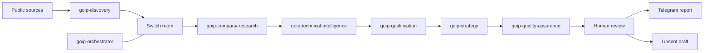

# System

The diagram a judge should use is [architecture.pdf](architecture.pdf), with the stage path in [execution-flow.pdf](execution-flow.pdf). The mermaid below is an older sketch. It draws the agents as if they called each other directly, and it draws Telegram as an output. Neither is how the code works. Discovery runs in the FastAPI workflow. The Switch room carries `GOIP-TASK` and `GOIP-RESULT`. The film does not show Telegram.

The room is Switch, not the model provider. Mattermost is the human composer attached to that room. FastAPI on `127.0.0.1:8001` reads and writes PostgreSQL. The browser is a static page served by the same app.

Connected sources: Hacker News, TechCrunch RSS, GitHub search by name, and one Crawl4AI query. Product Hunt, careers pages, and procurement portals are not connected.

Quality assurance can stop a service recommendation. Human review does not send it.
